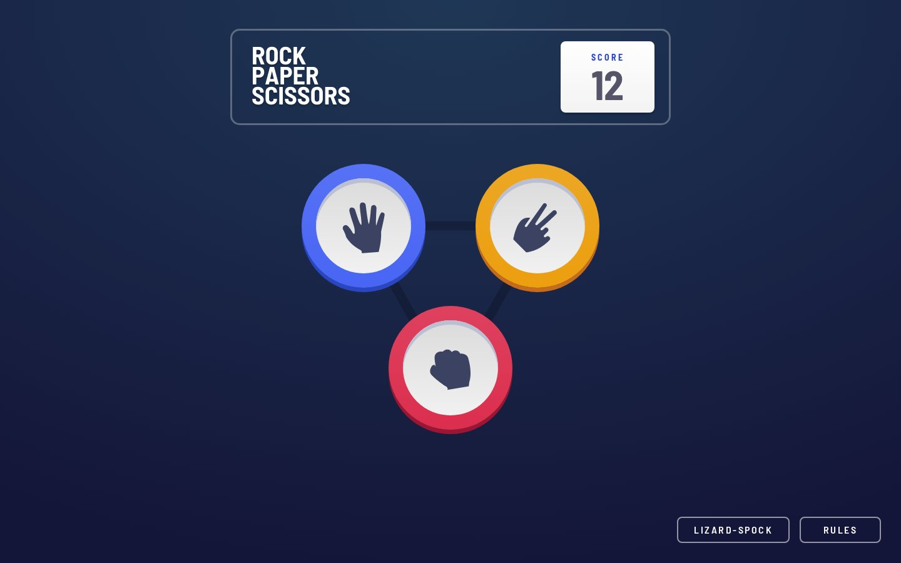
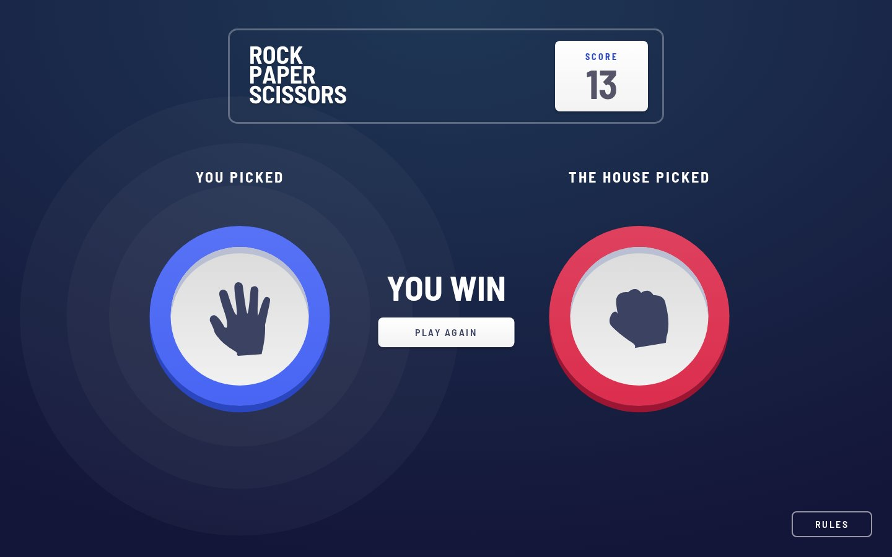
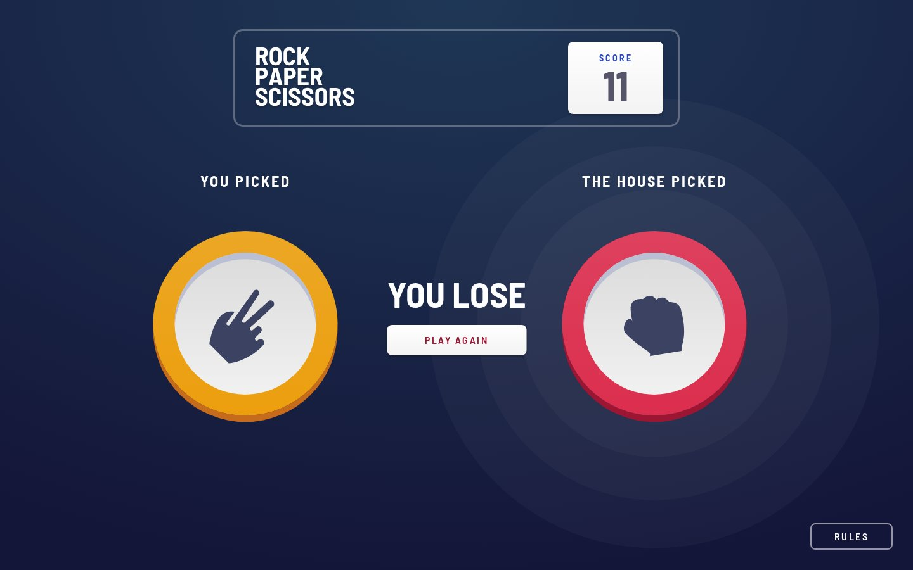
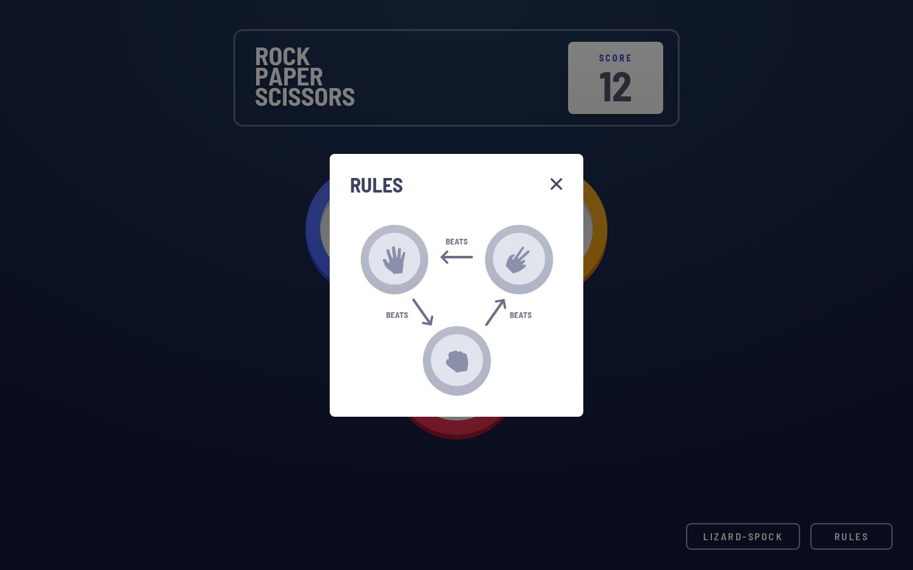
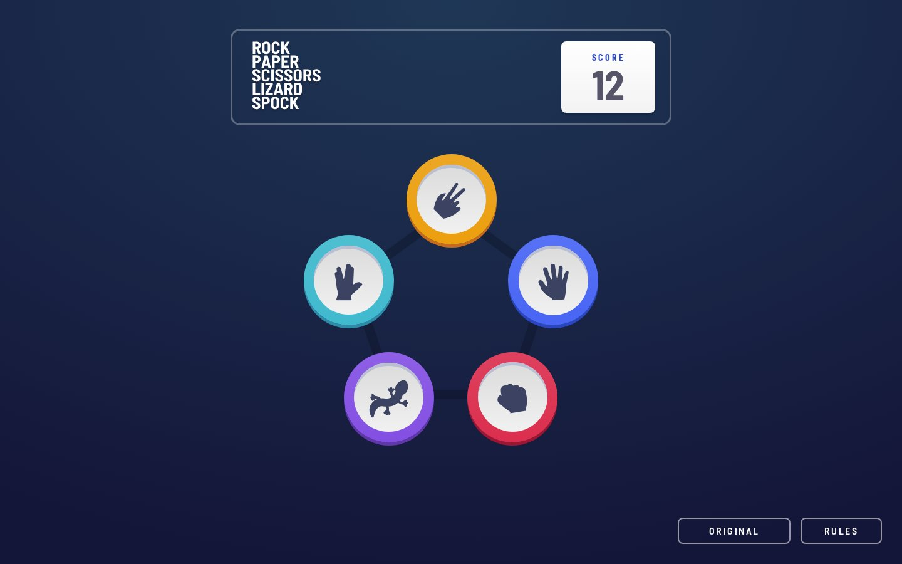
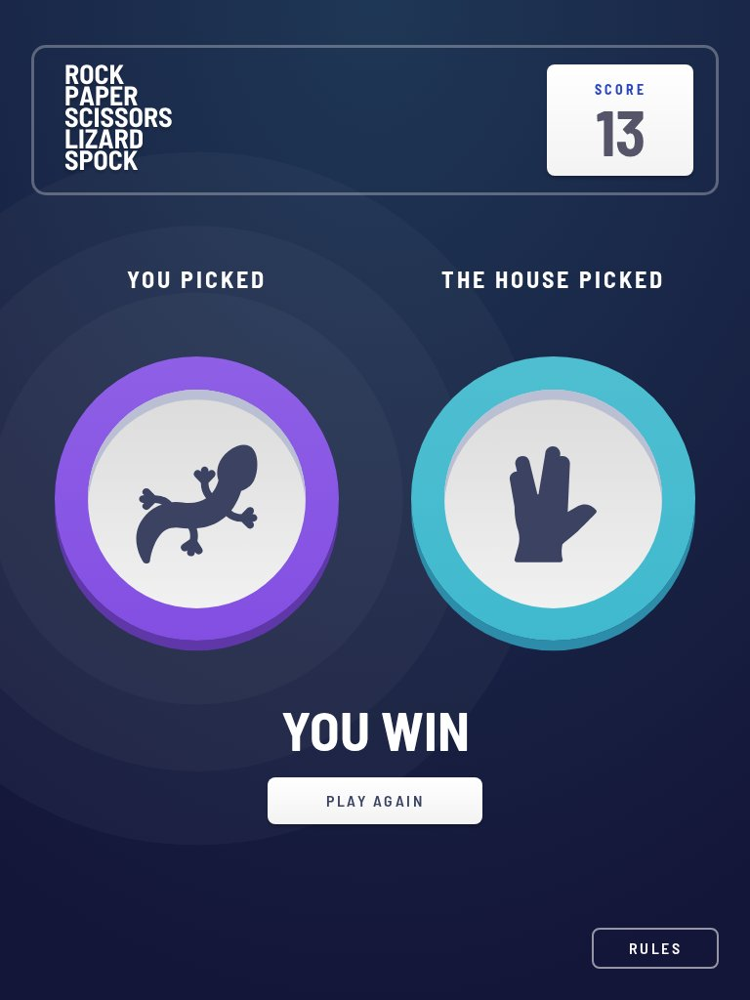
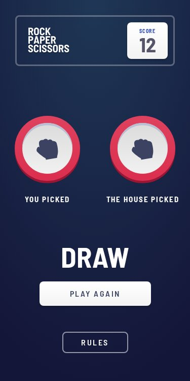
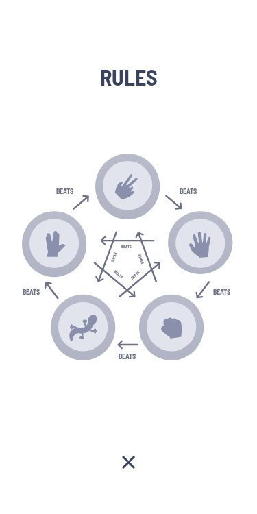

# Frontend Mentor - Rock, Paper, Scissors solution

This is a solution to the [Rock, Paper, Scissors challenge on Frontend Mentor](https://www.frontendmentor.io/challenges/rock-paper-scissors-game-pTgwgvgH). Frontend Mentor challenges help you improve your coding skills by building realistic projects.

## Table of contents

- [Overview](#overview)
  - [The challenge](#the-challenge)
  - [Screenshot](#screenshot)
  - [Links](#links)
- [My process](#my-process)
  - [Built with](#built-with)
  - [Workflow](#workflow)
  - [Tests](#tests)
  - [What I learned](#what-i-learned)
  - [Continued development](#continued-development)
  - [Useful resources](#useful-resources)
  - [AI Collaboration](#ai-collaboration)
- [Author](#author)
- [Acknowledgments](#acknowledgments)

## Overview

Rock, Paper, Scissors and its Lizard-Spock version against the computer, built with Svelte 5 and Tailwind CSS v4. Pick a sign with the mouse, a finger or the keyboard; the house picks at random; the result changes the score. Each version keeps its own score, and the score and the chosen version stay after a reload. The layout follows the designs from 320 px to large screens. 225 tests, written from a spec before the code, check it.

### The challenge

Users should be able to:

- View the optimal layout for the game depending on their device's screen size
- Play Rock, Paper, Scissors against the computer
- Maintain the state of the score after refreshing the browser
- **Bonus**: Play Rock, Paper, Scissors, Lizard, Spock against the computer

### Screenshot



| You win | You lose (Play Again hovered) | Rules | Lizard-Spock |
|---|---|---|---|
|  |  |  |  |

| Keyboard focus | Tablet, result under the signs | Mobile, a draw | Mobile rules |
|---|---|---|---|
|  |  |  |  |

### Links

- Solution URL: [frontendmentor.io/solutions/rock-paper-scissors-lizard-spock-svelte-5-tailwind-v4-playwright-XZIdVxKJa5](https://www.frontendmentor.io/solutions/rock-paper-scissors-lizard-spock-svelte-5-tailwind-v4-playwright-XZIdVxKJa5)
- Live Site URL: [ounokoya.github.io/rock-paper-scissors](https://ounokoya.github.io/rock-paper-scissors/)
- Repository: [github.com/ounokoya/rock-paper-scissors](https://github.com/ounokoya/rock-paper-scissors)

## My process

### Built with

- Semantic HTML: the game's logo as the only `h1`, the score in the `header`, signs as buttons named after them, the picked signs as two `figure`s named "You Picked" and "The House Picked", the result as an `h2`, a native `<dialog>` for the rules, and a status region that announces each result
- [Svelte 5](https://svelte.dev/) with runes, as a single page built with [Vite](https://vite.dev/) (no SvelteKit)
- [Tailwind CSS v4](https://tailwindcss.com/) — tokens from the style guide and the Penpot mockup in `@theme`, default palette removed; hand-written components with logical properties and lengths from `--spacing()`
- The game rules as pure functions (`src/lib/rules.js`): signs, who beats whom, the house's pick from a random number, the next score, reading saved values
- Starter images in `images/`; the rules diagrams and the close icon in `src/assets/`, as AA-corrected copies of the starter's files (darker "BEATS" labels and arrows, opaque close icon, a `viewBox` to scale), inlined in the page
- Boards with fixed proportions: tokens placed in container query units (`cqi`), so the triangle and the pentagon shrink as one below 375 px
- Barlow Semi Condensed served with the site through [Fontsource](https://fontsource.org/fonts/barlow-semi-condensed)
- [Playwright](https://playwright.dev/), [axe-core](https://github.com/dequelabs/axe-core), the W3C Nu validator, html-validate and ESLint for tests

### Workflow

Before any code, the design was analysed and rebuilt:

1. **Visual analysis in Excalidraw** — the 22 JPG designs measured to the pixel: screens, the flow of a game, interactive elements, a contrast audit and the questions the designs leave open (draw, switching versions, timing) → [`specs/visuel/`](./specs/visuel/)
2. **Penpot mockup** — colour and type library, tokens with their hover and focus states, key screens matched against the designs within 0.6–3 % → [`specs/visuel/penpot/`](./specs/visuel/penpot/)
3. **Spec, then tests** — 7 game rules, positions, states, accessible names and 19 Given/When/Then scenarios → [`specs/specifications/`](./specs/specifications/); the tests were written before the code and failed on the starter for the expected reason
4. **Decisions** — Svelte, tokens, font, how a game unfolds, saved values, the rules dialog, layout, references, publication → [`specs/adr/`](./specs/adr/)
5. **Code**, then a walk-through in a real browser from 320 to 1440 px → [`specs/analyse/`](./specs/analyse/)

### Tests

225 tests derived from the spec, at two levels:

- **7 unit tests** of the pure game rules (U1–U5) with Node's built-in test runner, no browser: `npm run test:unit` → [`tests/unit/`](./tests/unit/)
- **218 Playwright tests** of every user flow (S1–S19), on the build (`npm test` runs both levels) and on the live site (`BASE_URL=https://ounokoya.github.io/rock-paper-scissors/ npx playwright test`)

The tests replace `Math.random` in the page to choose the house's sign, and drive the page's clock to check each step of a game.

| What users can do | Scenarios | File |
|---|---|---|
| Play to the end with the mouse, then a finger, then the keyboard alone, at 375, 768 and 1440 px: win, lose and draw, each followed by Play Again; the score on screen and in storage, the halos behind the winner, each result announced; open and close the rules (Escape, the close button), focus kept in the dialog and given back, a game going on behind; switch to Lizard-Spock, win, switch back, reload | S1–S4 | [`interactions.spec.js`](./tests/interactions.spec.js) |
| Tab through every control to the last one at each step, with a visible outline; hover and focus states measured on screen; no motion with reduced motion | A7, S14, S15 | [`interactions.spec.js`](./tests/interactions.spec.js) |
| Get the right result for each of the 9 and 25 pairs of signs; see step 2 for 1 s and step 3 for 0.5 s, the score change only with the result; a house that picks each sign; saved values read safely; the version button at step 1 only | S9–S13 | [`game.spec.js`](./tests/game.spec.js) |
| See the designs' positions at 1366, 768 and 375 px (within 2 px), the rules centred on desktop and as a full page on mobile, the rules usable in a short window, and no horizontal scroll from 320 px | S5–S8 | [`layout.spec.js`](./tests/layout.spec.js) |
| axe-core at every step, in both versions and three sizes; landmarks, one `h1`, the rules as text | S16, S18, A1–A4, A10 | [`accessibility.spec.js`](./tests/accessibility.spec.js) |
| W3C Nu, html-validate and ESLint with Frontend Mentor's settings | S17 | [`static.spec.js`](./tests/static.spec.js) |
| The 22 designs replayed (same signs, same score) and compared with the JPG files: 0.6–3.1 % of pixels differ | S19 | [`visual.spec.js`](./tests/visual.spec.js) |
| Rules without a browser: every pair, the house's pick, the next score, saved values; the rules return names, never colours | U1–U5 | [`rules.test.js`](./tests/unit/rules.test.js) |
| Architecture rules: pure rules, colours only in the tokens, nothing loaded from other domains, three storage keys, no editable design file | ADR-0003–0011 | [`fitness.spec.js`](./tests/fitness.spec.js) |

### What I learned

**A board that keeps its shape.** The tokens sit on the corners of a triangle or a pentagon. The board is a container, and each token's position and size are percentages of its width in container query units, read from the designs; below 375 px the whole board shrinks as one:

```css
.board {
  container-type: inline-size;
  inline-size: min(var(--board), 100% - --spacing(16.125));
  aspect-ratio: 100 / var(--board-height);
}

.board .token {
  --d: calc(var(--token) * 1cqi);
  position: absolute;
  inset-inline-start: calc(var(--x) * 1cqi);
  inset-block-start: calc(var(--y) * 1cqi);
}
```

Every part of a token (edge, disc, icon, hover ring, halos) is a fraction of `--d`, so one token works at 95, 129, 144, 198 and 291 px.

**Testing a game of chance.** The house's pick is the n-th sign, with n = ⌊ `Math.random()` × number of signs ⌋. The tests replace `Math.random` before the page loads and queue the draws they need, then move the page's clock with Playwright to see step 2, step 3 and the result. axe-core waits on its own timers, so the clock resumes before each accessibility check.

**A `<dialog>` that stretched.** A modal dialog is pinned to the top and bottom of the screen; with `block-size: auto` it filled the whole height. `fit-content` keeps it at the size of its content, and `max-block-size` lets it scroll in a short window. A test now opens the rules at 1366 × 400.

**An SVG without a `viewBox` does not scale.** The Lizard-Spock rules diagram is 340 px wide, wider than a phone's page; without a `viewBox`, the smaller SVG was cut instead of shrinking.

**Focus at the right moment.** Focus moves to Play Again when the result appears, unless the rules are open. The effect also ran again when the rules closed, and took the focus away from the Rules button; reading the dialog's state with `untrack` keeps the effect tied to the result only.

### Continued development

- **What the designs leave open.** A draw is not drawn: it uses the result layout with "Draw", no halos and an unchanged score. There is no way to switch versions in the designs: a "Lizard-Spock" / "Original" button sits next to Rules, at step 1 only. The score can go below zero. The desktop designs are slightly off-centre; the layout keeps their positions.
- **Accessibility.** The rules' close icon is drawn in the dark navy at full opacity (it was 1.5:1), and "BEATS" and the arrows of the rules diagram use `#6b7087` (4.9:1 instead of 2.1:1); the rules are also given as text to screen readers. Every control has a white outline; each result is announced with the new score ("You picked Paper, the house picked Rock: you win. Score 13"), and so is a switch of version; nothing moves with reduced motion.
- **Next steps.** A short history of the last games, and a way to reset the score.

### Useful resources

- [MDN — CSS container queries](https://developer.mozilla.org/en-US/docs/Web/CSS/CSS_containment/Container_queries) — container query units such as `cqi`.
- [MDN — The Dialog element](https://developer.mozilla.org/en-US/docs/Web/HTML/Element/dialog) — modal behaviour, focus and `::backdrop`.
- [Playwright — Clock](https://playwright.dev/docs/clock) — controlling timers in the page.
- [Svelte docs — untrack](https://svelte.dev/docs/svelte/svelte#untrack) — reading state without making it a dependency.

### AI Collaboration

I used **Claude (Claude Code)** as a pair, inside my own spec-driven workflow where I validated each step before the next one:

- **Planning**: Claude proposed the scope and stack options; I chose the base game with both bonuses, Svelte 5, and the JPG designs with Penpot rather than a Figma file.
- **Design analysis and mockup**: Claude measured the designs, drew the Excalidraw analysis and built the Penpot mockup; I reviewed both and decided how to handle what the designs leave open (draw, version switch, timing) and the contrast fixes.
- **Spec and tests**: written by Claude before any code, from the validated mockup.
- **Technical decisions**: Claude presented options with their trade-offs in the ADRs; I approved them, and the font download.
- **Code**: written by Claude from the spec — I confirmed this split at the code lock — with the tests run at each step.

What worked well: the tests written first gave a precise target (each design within 5 %), and the first run pointed at real defects: the rules dialog stretched, the Lizard-Spock diagram cut on phones, Tab leaving the dialog. The walk-through in a real browser caught the rules dialog going off screen in a short window. What needed my decisions: everything the designs leave open, the contrast fixes, and every choice listed above.

## Author

- Frontend Mentor - [@ounokoya](https://www.frontendmentor.io/profile/ounokoya)
- GitHub - [@ounokoya](https://github.com/ounokoya)

## Acknowledgments

Challenge by [Frontend Mentor](https://www.frontendmentor.io?ref=challenge): designs, icons and the rules from the starter files.
